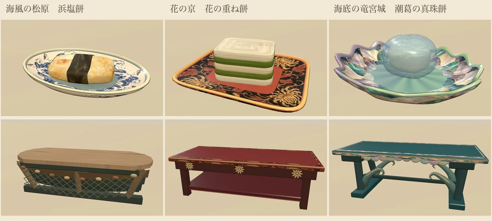

# 十七景もち寄り帖　造形と実画面の検版

## 土地の工芸

松原の網仕事台は舟板と綱で組み、持ち手の横に浮きを掛けた。京では菊唐草の角盆に白餅と抹茶の層を重ねた。竜宮では貝片をはめた波形の脚、貝の器、透ける葛の皮が同じ卓で見える。十七種の器と卓の形は、各土地の暮らしをもとにした創作である。筆線、余白、動物同士の目配せは指定の模本を参照した。[ColBase「鳥獣戯画（模本）」](https://colbase.nich.go.jp/collection_items/tnm/A-1530?locale=ja)

蔵町の器は四隅を落とした厚手の角皿で、幅広の高台がある。楓峡では楓文を真円の皿に載せ、松原と敦賀の長皿は楕円、伏見の折敷は角を丸めた四角にした。

個々の模型を照明下で撮影し、現地の墨絵処理を通した画面と比較した。暗い室内でも漆と螺鈿の色が判別できるよう調整した。雪の宿の胡桃だれに生じていた欠けを直し、十七景の餅、器、卓の頂点と法線、接触面を検査した。[十七種の餅と器](food.webp) ／ [十七か所の仕事台](settlements.webp) ／ [現地での比較](regions.webp)

## 人物と物証

五十九人の全身を描画し、頭巾、前掛け、肩当て、背負い荷、手道具の位置を確認した。墨八は腕の吸盤で品を支え、大吉は鼻先で盆を受ける。手伝いのいる作業では、案内する住人と手元を受け持つ配達人の名を字幕に出す。[人物五十九人](cast.webp) ／ [鼻先から盆を受け取る場面](handover.webp) ／ [墨八が箱を寄せる場面](palace-box.webp)

港の通い箱は蓋に残った傷を調べる。事故で落ちた箱では割れた蝶番を照合する。蒸し器には米に火を通すための段と桟があり、弥平が預ける曲げわっぱの蒸籠は薄板を曲げて綴じてある。用途ごとに異なる部分を持てるよう、蓋、上段、桟、敷板、受領書をそれぞれ可動にした。[箱と蒸し器の比較](carriers.webp) ／ [各調査で使う品](evidence.webp)

## 実演と回想

現地の仕事台で、人物が品を取り、返し、並べ、手渡す。合わせ餅の接写でおはなの口元が片側の葉脈を隠していたため、餅を前へ出し、カメラを横へ移した。二枚の葉脈の向きと中央の継ぎ筋を画面で確認できる。桜葉の数え跡と餅の裏は別々の場面に記録する。縦画面での試作蒸し箱は、外した上段と下段の三本の桟が同時に見える構図にした。[おはなが実際に餅を返す場面](study.webp) ／ [縦画面で桟を数える場面](steamer-mobile.webp)

聞き込み、調査、推理の正答、土地の餅、七話と終幕の結びは「場面の回想」へ残る。弥平の竹細工場での仕事と、桃林で預けた道具の話をする休養場面は別々に残る。一度見た場面は旅先から同じ場所・同じ役者で見直せる。途中で帳面へ戻れる。過去の版で既に獲得した証言と解決済みの問いも回想できる。

## プレイヤー検証

七つの謎と終幕について、遠隔地間の移動を検査用に短縮し、ゲーム画面から証言を記帳し、証拠と理由を選んで、祭の結びまで進めた。誤答後の再挑戦、章をまたいだセーブ再開、回想後の進行状態の一致を確認した。デスクトップの WebKit と幅390ピクセルの Chrome では、初見の中断、記帳、五十一件の調査の回想、全拍の字幕送りを操作した。[京の白洲](court.webp)

作品全体の自動テストには配達、移動、入浴の回帰検査のほか、場面と手掛かりの対応、古い帳面の復元、動く部位、卓と当たり判定が含まれる。

公開用ファイルを梱包したローカルの Cloudflare Workers で、初見から記帳・再読み込み・回想まで進め、161場面417拍をすべて描画した。実行時エラーは0件。自動テストは302件すべて通過した。[桜川で餅を取って返す実演の連続撮影](turning-the-mochi.webp)
