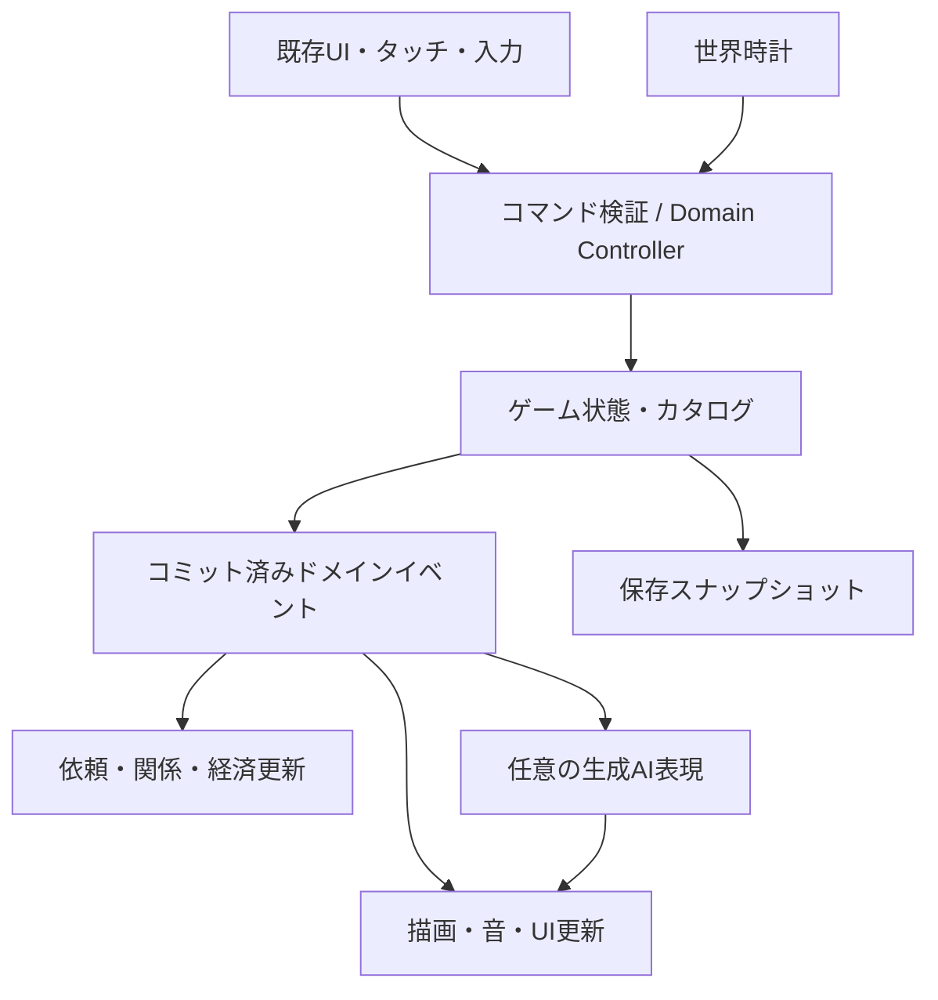

# システムアーキテクチャ・データ・イベント契約

Three.jsブラウザゲームの構成を維持し、状態を持つ生活システムを小さな独立モジュールとして追加する。描画・入力・保存とゲームロジックを分離する。

## 基本アーキテクチャ

**ARCH-01 [DESIGN]** 既存の `two/` を対象とし、JS ES modulesと既存Three.jsを維持。ゲームのルール関数をDOM/Three.js/ネットワークから独立させる。外部フレームワークやサーバーDBへの全面移行は不要。以下のファイル名は責務を示す案であり、既存コードに合わせて調整する。



AIから状態や進行への戻り矢印は存在しない。採用された名前/説明、感想の文字列だけを、明示された表現フィールドに保存する。ゲームルールの変更はロジックからのみ。

| モジュール案 | 主な責務 | 所有設計 |
|---|---|---|
| `world-clock.js` | worldMinute、時間帯、待機、境界処理 | [時計](world-clock.md) |
| `living-catalog.js` / `data/` | 素材・技法・設備・地域の静的定義、ID検証 | [地域](world-regions.md) |
| `resource-system.js`, `inventory.js` | 資源点、取得・移動・消費・取引の原子性 | [資源](resources-and-farming.md) |
| `mochi-crafting.js`, `mochi-appearance.js` | レシピ正規化、検証、属性、ロット、描画キー | [餅](mochi-crafting.md) |
| `market-system.js` | 商店、無人販売、価格、需要、売上履歴 | [市場](market-and-trade.md) |
| `building-system.js`, `terrain-modifications.js` | 候補地・設置・伐採・撤去・差分 | [建築](building.md) |
| `farming.js` | 畑/水田、成長・収穫・灌漑 | [栽培](resources-and-farming.md) |
| `npc-routines.js`, `npc-relationships.js` | スケジュール、好み、記憶・実食イベント | [住民](npc-simulation.md) |
| `quest-system.js` | 条件/イベントと依頼進行 | [依頼](quest-system.md) |
| `mochi-text.js` (+ optional provider) | テンプレートと任意のAI、検証、キャッシュ | [生成AI](generative-ai.md) |
| `world-save.js` | 保存・検証・移行・エクスポート | [保存](save-and-migration.md) |

小さい実装に不要なファイルを大量生成しない。機能を追加するたびに関連責務を明確にし、実装されたモジュールの位置はWikiに反映する。共通ヘルパーは必要が生じた時点で作る。

## データの分類と所有権

**ARCH-02 [DESIGN]** カタログ定義は読み取り専用・安定した文字列ID、プレイヤー状態は単一の論理的な正本（既存stateと互換な拡張領域）。表示モデルは派生。描画オブジェクト、関数、DOM、GPU、AIプロバイダをセーブしない。

| データ | 正本の担当 | 例 |
|---|---|---|
| `catalog` | 定義モジュール | resource, recipe template, module, technique, npc, offer, regionId |
| `time` | world-clock | worldMinute, seed, process cursor |
| `holdings` | inventory | wallet, resource stacks, recipe batch quantities by location |
| `recipes`, `batches` | mochi-crafting | 配合、属性snapshot、名前/説明、作成履歴 |
| `camps`, `structures`, `worldChanges`, `plots` | building/farming | 土地・伐採・建物・栽培の差分 |
| `markets`, `stands`, `sales` | market | 在庫、cashbox、販売実績、settled bucket |
| `npcState`, `contacts` | npc | 関係、実食、NPC知識、秘境権限 |
| `questState`, `eventFlags` | quests | 新規依頼、完了/報酬、世界フラグ（旧storyとは別） |
| `textResults` | 表現層 | 採用文章と反応。ルール上の権威なし |

単位：座標は既存ワールドのメートル相当・角度は既存規約（内部rad等、UIで度表示）、時刻は整数ゲーム分（補間に固定小数可）、素材の量はカタログ単位の整数、通貨は整数「文」（暫定）。属性は整数0〜100。NaN/Infinity、負の数量、範囲外座標、存在しないID、桁あふれは拒否。`regionAt` のindexから `REGIONS[index].id` を得る。ラップ座標を既存関数で正規化。

## コマンド・イベント

**ARCH-03 [DESIGN]** 変化を伴う操作は `validate -> calculate -> commit -> emit`。検証失敗時に途中状態を残さない。ゲームの正本への書き込みはコマンドハンドラに集約し、UIで直接数量を増減しない。例：

```js
// Proposed contracts; adapt to repository style.
craftMochi({recipeDraft, stationId, count, commandId})
placeModule({campId, moduleId, transform, commandId})
gatherResource({nodeId, toolId, commandId})
listBatch({standId, batchId, quantity, price, commandId})
collectRevenue({standId, commandId})
giftBatch({npcId, batchId, quantity, commandId})
advanceWorld({minutes, reason, commandId})
// => { ok: true, events: [...], result: {...} } or { ok: false, reason: ... }
```

各イベントは `eventId, type, minute, subjectIds, payloadVersion, payload`。例 `ResourceGathered`, `BatchCrafted`, `BatchTransferred`, `StandSaleSettled`, `GiftAccepted`, `NpcTasted`, `ModulePlaced`, `TreeRemoved`, `CropHarvested`, `QuestCompleted`, `TimeAdvanced`。名前は案。イベントの二重処理を防ぐ。ドメイン操作が完了する前にAIや描画処理を呼ばない。サブシステム間で在庫/通貨を二重に管理しない。無限イベントログを保存せず、必要な集計/既処理カーソル・最新履歴に圧縮。重要な報酬/事実IDは保持。

## 時間・負荷制御

**ARCH-04 [DESIGN]** レンダリング毎フレームではなく、領域ごとの必要粒度で更新。物理・入力は既存フレーム処理。世界時計は実秒差分→ゲーム分、農業は成長区間/日境界、経済は15ゲーム分等の固定bucket、NPCは予定変更/一定間隔、描画は近距離のみ。待機ジャンプ時は同じドメイン処理を時刻順に一括実行。市場/農業/資源で境界が飛ばないようにする。物理ループを大量に早送りしない。遠距離の資源・NPC・販売は集計/遅延計算。長時間ジャンプ時は処理量上限と分割、UIに結果を示す。seedと安定ID順で同一入力に対して再現可能な結果。

### 目標・計測

新機能OFFとON、既存主要景と拠点の実機計測（FPS/フレーム時間、初期ロード、メモリ、セーブ容量）。初期の目標案は同じ機器・同じ景で既存版の中央値フレーム時間から10〜15%程度以内の増加を目指す。モバイル低描画設定で操作継続可能。実測により上限やLODを調整し、性能を保証したとは記載しない。モデルの自動ロードを避ける。フレームループで同期的な重い保存・推論・全NPC走査を行わない。時間処理・大規模計算は必要ならWorkerへ移す（先に計測）。

## テスト構成

純粋関数・データ整合の `node:test`、状態遷移の統合テスト、実ブラウザのキーボード・タッチ・保存・昼夜・景観・描画。既存 `npm test` とビルド（現行スクリプト確認）を通す。フェーズごとに実際のプレイを成立させる。詳細は [受け入れテスト](acceptance-tests.md)。

## 関連ページ

- [既存コード](current-repository.md)
- [保存](save-and-migration.md)
- [時計](world-clock.md)
- [餅](mochi-crafting.md)
- [依頼](quest-system.md)
- [AI](generative-ai.md)
- [実装計画](implementation-roadmap.md)
