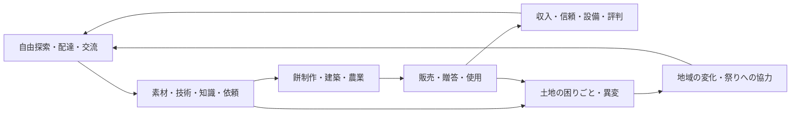

# ゲーム全体設計とコアループ

鳥獣戯画の世界で、お餅として旅し、暮らし、食文化を創造し、住民と関係を築く。もち寄り祭は世界を貫く物語の軸だが、生活を強制しない。

## 目標と非目標

- **VISION-01 [REQ]** オープンワールドの既存資産を生かす。生活（どうぶつの森）・社会と事件（GTA/RDR2）・自由探索/組み合わせ（ゼルダ）の融合。非戦闘の世界観とお餅の魅力を維持する。
- **VISION-02 [REQ]** 探索・交流で材料を獲得し、独自の餅と拠点を作り、立地と商品によって売上が変わる無人販売所を運営できる。米は購入しても栽培してもよい。
- **VISION-03 [REQ]** 初心者が少ない操作で楽しめ、上級者は配合、設備、土地、商売の最適化を追求できる。物語のためだけに作業を繰り返す設計にしない。
- **VISION-04 [REQ]** 現フェーズはゲームシステムを作り込む。メインストーリーの詳細は後工程。固定された前提だけを [祭りと物語](festival-story-boundary.md) に定義する。
- **VISION-05 [DESIGN]** 進行を止める飢餓、睡眠義務、枯死、オフライン中の損失、破産、強制的な祭り失敗を導入しない。通貨がなくても基本的な配達・採集で立て直せる。すべての活動・NPCコンプリートを要求しない。
- **VISION-06 [DESIGN]** プレイヤーごとに異なる餅、拠点、関係、旅の履歴が残る。プレイヤーの創作餅（食べ物）は主人公や他の餅の住民とは別物。住民を食材にする仕組みは導入しない。

## 遊びの循環

個々の活動を進めなくても他の活動を楽しめること。農業をしない人は買う、商売をしない人は配達報酬で設備を用意する、建築に興味がない人は公共工房を利用する。祭りを進めたい人も任意の暮らしに戻れる。

| 時間規模（目安） | 主体験 | 成果 |
|---|---|---|
| 30秒〜3分 | 採集、配達、入浴、会話、試食 | 素材・少額報酬・発見 |
| 5〜15分 | 餅制作、贈答、販売所の設置、短い依頼 | 独自の商品・人脈・新たな技法 |
| 15〜60分 | 拠点の改良、農業、複数景の交易、地域エピソード | 生活圏の形成、収入、信頼 |
| 数時間以上 | 十七景探索、名物餅作り、祭りへの貢献 | 自分の旅の成果・後工程の物語 |

## 成功の判断

初めてのユーザーが短い導入を経て餅を1品作り、誰かに渡すか売れること。経験者は既存レシピに縛られず、違う土地・味・用途の餅を作れること。どの拠点立地にも魅力とトレードオフがあり、最適解が一つに固定されないこと。プレイヤーの任意の行動から地域の小さな物語へ接続できること。性能と操作感は既存版を基準に検証する。

## 設計の優先順

1. 手触りのよい餅作りと探索・経済の縦断ループ。
2. 拠点の選択と創造、農業、NPCの日常による世界の厚み。
3. 状態とイベントを使った地域ミッション基盤。
4. メインストーリーの新規設計・制作（別途承認）。

生活の楽しさを損なう追加メカニクスは、シナリオやシミュレーションの都合だけで採用しない。

## 関連ページ

- [決定記録](decisions.md)
- [餅クラフト](mochi-crafting.md)
- [祭りと物語の境界](festival-story-boundary.md)
- [UX](user-experience.md)
- [実装計画](implementation-roadmap.md)
